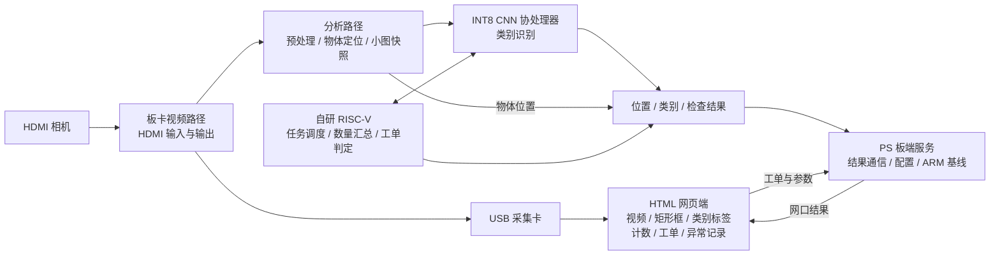

# 边缘慧眼（EdgeSight）——基于自研 RISC-V 的片上视觉分析仪

> 全国大学生嵌入式芯片与系统设计竞赛'2026 · FPGA 创新设计赛道 · **AMD 自主选题赛道（初级组）** 参赛作品仓库

**目标形态**：在 AMD PYNQ-Z2（Zynq-7020）上，用**自研 RISC-V 核、HDMI 视觉流水线与 INT8 CNN 协处理器**分析相机拍到的紧固件。前端为 **HTML 网页端**：视频经板卡 HDMI OUT 与 USB 采集卡进入 PC，识别结果经网口从板端服务同步；统一展示物体矩形框、类别标签、数量统计、工单缺件/错料提示和异常记录，并与 ARM 软件基线对比。

---

## 目录

- [项目背景与创新点](#项目背景与创新点)
- [系统架构](#系统架构)
- [三大核心模块](#三大核心模块)
- [软硬件划分与接口](#软硬件划分与接口)
- [性能指标与基线对比](#性能指标与基线对比)
- [仓库目录结构](#仓库目录结构)
- [开发环境与复现](#开发环境与复现)
- [开源协议](#开源协议)
- [参考资料](#参考资料)

---

## 项目背景与创新点

装配工位需要核对紧固件的类别和数量，并将识别结果与工单要求比较，发现缺件、多余件和错料。本项目以“相机采集 → 定位与识别 → 工单检查 → 界面与记录”为目标；网页端已接通真实板端 API、USB 视频和检查快照，连续稳定性与分类精度仍待完善。当前已实现能力、实板结果和整机验收缺口见 [plan.md §3.1](plan.md#31-当前状态)。

本作品的定位是**桌面紧固件识别与工业检查系统**：板卡承担视觉分析和检查调度，HTML 网页端承担统一显示与记录；网页工单配置、持久记录和异常截图仍为目标。

本作品给出的答案是：**在 FPGA 里造一颗为视觉任务定制的 SoC**——

1. **自研三级流水 RISC-V 核（而非直接例化现成软核）**：以两级流水基线为对照，通过流水线重构、数据转发（旁路）、轻量分支预测优化 CPI，把"流水线优化"本身作为可量化验证的设计内容；
2. **RTL 图像预处理硬件流水线**：HDMI 视频流逐像素实时处理（灰度化 → 高斯滤波 → 缩放/边缘），与 OpenCV 软件基线对比延迟与帧率；
3. **轻量 CNN 推理协处理器**：v0 已冻结为 RISC-V 本地 MMIO、PS AXI4-Lite 控制和 DMA 数据面，采用 INT8 小图分类，与 ARM Cortex-A9 软件推理对比。

---

## 系统架构



> 上图为功能架构，当前共存部署的识别路径是原彩色捕获→DDR→PS定位/ROI→DMA→PL CNN→核侧工单判定→PS API→网页。原视觉RTL另有彩色显示与预处理/片上快照分流，见[视觉契约](src/vision/design_v0.md)；该诊断分析链不代表当前CNN实际输入。状态与实板证据统一见[主计划](plan.md#31-当前状态)。

**演示目标闭环**：放入紧固件 → 网页端展示实际识别框与类别 → 按工单核对类别和数量 → 缺件/错料提示 → 保存本次检查结果与异常截图。当前网页仅本页内存记录与CSV；持久批次/异常截图未实现。连续自动轮不累计批次，断联或过期撤除结果；轮次级叠加不等于逐帧对齐。

---

## 三大核心模块

### 模块一：自研三级流水 RISC-V 软核（流水线优化专项）

- 指令集：RV32IM（整数 + 乘除），按需裁剪
- 基线：两级流水（IF / ID+EX+MEM+WB）
- 优化手段：
  1. 重构为**三级流水线**（IF / ID+EX / MEM+WB），提升主频
  2. **数据转发（旁路）电路**，消除 RAW 数据冒险气泡
  3. **轻量化分支预测**（1-bit/2-bit BHT），减少跳转冲刷
- 验证：riscv-arch-test 子集 + 自写 benchmark（Dhrystone 思路的整型测试程序）

### 模块二：HDMI 图像预处理硬件流水线

- HDMI IN → 解码 → 逐像素流水线：RGB→灰度 → 3×3 高斯滤波 → 双线性缩放（至网络输入尺寸）→ 可选 Sobel 边缘
- 行缓存（Line Buffer）调度，全流水无逐帧 DDR 回写依赖，**像素级延迟固定可测**
- **参数化链路**：当前 PS 经 AXI-Lite 配置视觉寄存器，配置原子生效；RISC-V 应用调度接入尚未实现
- **架构对比点**：行缓存直通 vs 传统"DDR 帧缓存回写"方案，延迟/带宽/资源三列实测对比（借鉴往届国一作品 Ultra-Vision 的"算法直出"架构，见 [docs/research/proposal_upgrade.md](docs/research/proposal_upgrade.md)）
- 对照组：PS 侧 OpenCV / 裸机 C 软件实现同算法

### 模块三：轻量 CNN 推理协处理器

- 形态：RISC-V本地MMIO + PS AXI4-Lite控制面，现行DMA搬运权重及逐目标ROI，结果经MMIO读取；结果DMA未接入，不启用自定义指令。现有整帧灰度快照不能代替原分辨率逐目标裁剪。
- 目标任务：对自由分散、互不遮挡的螺栓、螺母、垫圈定位后，统一生成64×64灰度ROI，再按C02量化供FastenerCNN分类。r6已有实板整数参考逐项对照；独立精度与正式工位验收未完成，数值一致不能代替类别正确。
- 当前软件栈：PC训练/量化/导出→PS装载与DMA/触发→PL CNN→RISC-V裸机工单判定；模块间分工以C03与实板记录为准。
- 对照组：同一网络在 ARM Cortex-A9 上的纯软件推理
- **算子化验证**：CONV/POOL/GEMM 单算子逐一给出 ARM 基线加速比表（对标往届 HLS 算子赛道的评分打法）
- **同界面切换**：网页端切换“ARM 软件推理 / 协处理器推理”，同输入对比结果与耗时；Jupyter 保留为板端调试和复现入口。

---

## 软硬件划分与接口

| 层级 | 承担者 | 职责 |
|:---|:---|:---|
| 实时像素处理 | PL（RTL 流水线） | HDMI 输入输出、视频/分析分流、预处理；定位与逐目标 ROI 由 PS 完成 |
| 算力密集推理 | PL（协处理器） | CNN 卷积/全连接加速 |
| 任务控制 | PL（RISC-V 核，裸机 C） | 快照与推理调度、数量汇总、工单判定 |
| 板端服务/基准 | PS（PYNQ） | 寄存器配置、结果通信、ARM 软件基线、黄金参考与指标采集；Jupyter 调试 |
| 工业操作界面 | PC（HTML 网页端） | 采集卡视频、框与标签叠加、工单配置、统计、异常截图与记录导出 |

---

## 性能指标与基线对比

各指标分别标明仿真、实现或真实板卡口径，每组数据给出测试条件与原始日志。

| 指标 | 基线 | 目标 | 对比对象 |
|:---|:---|:---|:---|
| RISC-V 核 CoreMark CPI | v1 无转发 1.885683 | 固定乘法器仅转发门禁≥8.0%；组合25%为尽力目标 | fwd 1.693399（10.20%）；BHT2 1.606121；v0仅外部锚点，见收口报告 |
| RISC-V CoreMark/MHz / 每MHz面积归一值 | v0短迭代仿真外推1.506 | v0锚点及v1四档已入报告 | 同核参数矩阵；PicoRV32不同负载数据不作同负载加速比 |
| RISC-V 核通过约束点 / WNS | v0同脚本外推83.8MHz | BHT2核86.806MHz实点WNS≥0；100/125MHz非阻塞 | BHT2 WNS=+0.538；SoC/上板单列40MHz |
| 图像预处理延迟 | 软件 OpenCV 实测值 | 降低 ≥ 10×，逐像素固定延迟 | PS 侧软件实现 |
| 直通 vs 帧缓存架构对比（延迟/带宽/资源） | DDR 帧缓存参考实现 | 直通优势量化在案 | 自建对照组 |
| 板端视频延迟（输入 → HDMI 输出） | 软件链路实测值 | ≤ 1 帧的目标；采集卡/网页端显示延迟另测 | PS 软件实现 |
| 视频显示帧率（网页端 / 采集卡） | — | ≥ 30 fps，识别结果更新率另行实测 | — |
| CNN 推理单帧耗时 / 能效 | ARM A9 软件推理实测值 | 加速 ≥ 5× | 同网络同量化 |
| 资源占用 | — | LUT/FF/BRAM/DSP 均在 XC7Z020 内留 ≥ 20% 余量 | — |


---

## 仓库目录结构

> 目录与文件名使用英文，中文用于正文；根目录放项目 README、主计划、仓库规则与许可证，各模块目录维护自身的源码、说明和接口。
> 📖 目录导航与"找东西"规则（日志/证据/计划各自放哪）：[docs/README.md](docs/README.md)；每个文件夹的职责见其目录内 README。

```
edgesight/
├── README.md            # 本文件（项目简介 + 复现步骤，指南 §3.3.5.4 提交物要求）
├── plan.md              # 全项目目标、验收口径与当前状态
├── LICENSE              # MIT 协议
├── src/                 # 设计源码（RTL / 固件 / PS 侧软件）
│   ├── riscv/           # v1 三级＋转发＋BHT 核与最小 SoC
│   ├── vision/          # HDMI 预处理/捕获状态 RTL
│   ├── coprocessor/     # C02 整数参考、CNN 算子与整网控制器
│   ├── riscv_fw/        # RISC-V 裸机固件（冒烟 / 逐指令自检 / 后续 benchmark）
│   ├── pynq_host/       # PS配置、定位/FP32参考、MOCK与FILE/LIVE服务骨架、记录/CSV参考
│   └── web_client/      # HTML 网页端前端（HUD v4 外壳）
├── sim/                 # testbench、仿真脚本（scripts/ 一键 iverilog；tools/ 含 RV32I 编解码自测）
├── build/               # Vivado 可复现构建 tcl + 综合/实现报告
├── board/               # 上板步骤、运行脚本与已有实机记录
├── data/                # 测试数据与参考结果（metrics.csv + logs/ + evidence/ + golden/ + scripts/）
├── models/              # FP32 CNN 原型权重（现役 r6 见 data/evidence/）
├── results/             # 外包实验逐图评估/训练记录（结构例外，不移动）
├── skill/                 # 技能包（含 understand-gate 入库理解门槛 skill）
├── report/                # 设计报告 + 大模型协作记录（llm_log/）
├── docs/                  # 过程文档与导航（入口：docs/README.md；地图：docs/project-map.md）
├── .github/               # PR 模板（仓库基础设施，不属作品结构对照范围）
└── .gitignore             # 忽略编译产物（*.hex/*.coe 明确入库）
```

### 与赛题指南推荐目录的对照

> 本赛道（AMD 自主选题）指南 **§3.3.5.4** 为**推荐结构、非强制**；采用其他组织方式的队伍须在 README 中给出目录对照说明，下表即该说明。
> 顶层目录与官方骨架一一对应。

| 本仓库 | 指南 §3.3.5.4 推荐 | 说明 |
|:---|:---|:---|
| `src/` | `src/`（设计源码） | RTL 三个子目录（`riscv/` 含 SoC 外壳）+ `riscv_fw/` 固件 + `pynq_host/` PS 侧软件 |
| `sim/` | `sim/` | testbench、仿真脚本与结果 |
| `build/` | `build/` | 可复现构建脚本＋已有核／SoC／视觉综合实现报告 |
| `board/` | `board/` | 上板工程、运行脚本与实测输出 |
| `data/` | `data/` | 测试数据、黄金参考与 `metrics.csv` 指标汇总（含 `logs/`、`scripts/`、`evidence/`） |
| `models/`、`results/` | —（指南未列） | FP32 原型与历史实验结果；接收收据见 `data/evidence/2026-10-10-fastener-handoff/`，当前模型见 r6 包 |
| `skill/` | `skill/` | 技能包（大模型协作沉淀，加分项） |
| `report/` | `report/` | 设计报告 + 大模型协作记录（`llm_log/`） |
| `docs/` | —（指南未列） | 非强制扩展：过程文档集中地（onboarding / 清单 / 赛题调研） |
| `.github/` `.gitignore` | — | 仓库基础设施，不参与作品结构对照 |

> [data/metrics.csv](data/metrics.csv) 已有核／视觉指标与原始日志链接；工业闭环指标待实测。指标口径见 [data/README.md](data/README.md)。

---

## 开发环境与复现

- 板卡：AMD PYNQ-Z2（XC7Z020）；已烧录 PYNQ 镜像并开通校园网 SSH 远程访问（`ssh xilinx@<板卡内网IP>`，详见 [board/README.md](board/README.md)）
- 工具链：Vivado / Vitis 2026.1（BASIC 免费档；XSim 限 50K 实例、仅 Windows，对本项目核级 tb 够用；2025.2 ML Standard 为回退备选，见 issue #2）、RISC-V GCC 工具链（MSYS2 ucrt64 `riscv32-unknown-elf`，RV32IM，见 [src/riscv_fw/README.md](src/riscv_fw/README.md)）、PYNQ v3.x 镜像
- 复现步骤：见 `board/README.md`（从零烧录 SD 卡 → 构建 bitstream → 运行演示）

---

## 开源协议

本项目采用 [MIT License](LICENSE) 开源。

---

## 参考资料

完整的分类资料清单（FPGA / SoC / RTL / CNN / PYNQ / HDMI / 体系结构，共 40+ 站点）见 **[docs/research/resources.md](docs/research/resources.md)**。
