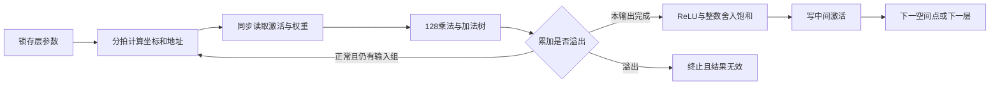

# CNN / DDR 离板交接（2026-10-13）

基线 `3e2e1c9`，`dev/model`，新增未提交。用户选择 CNN MAC 优先、快速模式且理解题留到最后；当前只做离板事项。

## 可交付范围

- CNN：完整固定结构的整数软件参考、128路乘法阵列、分拍地址/运算、四Conv→GAP→FC控制器与逐元素诊断tb。
- 综合：控制器OOC默认Verilog-2001，100 MHz设定下WNS+0.058 ns、WHS+0.049 ns，192 DSP、10,100 LUT、6,940 FF；裕量很小，外部存储/视频/SoC未计入。
- DDR：单帧所有权候选驱动，七组离板异常测试通过。完整custom帧实测未成功；两次启动前失败均恢复原vision。
- 输入/版本：65个源文件与两组未训练诊断黄金已存档并核对SHA256。正常整网对拍检查73,795个有效元素，各1,123,109拍（含1/7暂停）；[总回归](../data/logs/2026-10-13-cnn-arithmetic/README.md)已PASS、退出0，核四档、视觉与全部新增项通过。

不将本包视为正式模型、可下载整机位流、真实识别或M2验收。当前机位距离/背景/光照仍是临时测试条件。

## CNN 存储与时序接口

`cnn_sequencer.v` 的外部存储端口是假定的一拍同步读，CE停顿期间返回数据保持；所有银行共享复位，整个busy窗口模型/ROI不可变。实体存储和主机装载器尚未实现。

| bank | 数据 | 逻辑地址单位 / 容量 |
| --- | --- | --- |
| 0 | 单通道ROI | 4,096个INT8像素；读口仅低字节有效，上7lane生成0；不把DDR ROI扩大8倍 |
| 1 | ping | 4,096个64-bit C8HW8 word，32KiB |
| 2 | pong / FC输出 | 2,048个64-bit word，16KiB；FC最后仅低3byte有效 |
| 3 | GAP | 8个64-bit word，64byte |
| weights | O16/KH/KW/I8 | 269个1,024-bit word，34,432byte；输入lane变化最快 |
| parameters | bias/multiplier/shift | 160个逻辑OC槽（含13个尾槽）；每次读16个输出通道 |

五层权重逻辑基址为0/9/45/117/261，参数OC基址0/16/48/80/144。
这些是**内部word/OC索引，不是生产包DDR字节offset**。正式导出器仍须按C02为每层weight、bias、multiplier和shift分别做64byte对齐，并提供offset/length、scale、CRC/SHA等manifest。TB hex不可直接作为正式DMA包。



valid表示流水线中哪一拍的数据可用，不能只固定等待几个墙钟周期；CE暂停必须同时保持数据与valid。复位/abort清valid后，旧结果不会成为下一任务输出。
完整结果仅在`done && !error`后可读；busy期间的feature写是中间数据，不能提前发布。

`ready`只是计算器空闲条件，**不是C03的配置/模型/ROI验证READY**；start时清本地旧结果，也不替代C03要求的显式CLEAR_DONE/CLEAR_ERROR。MMIO封装必须保留完整sticky终止状态和权限规则。
INT8范围/权重稳定/累加界由正式模型装载器预检，运行时另拒绝MAC溢出与非法requant参数。内部margin输入8bit，C03外部配置须额外限定0–254。

## DDR 所有权与返板条件

单帧 park slot0，FrameCntEn=1、IRQFrameCount=1。IRQ不能单独授权复制；须联合确认自动RS清0、Halted、无DMA/CAP新增错误、正确slot/描述符与同一boot/overlay实例。停机状态接受并丢弃的stream_seq变化不作为DDR完成证据。

确认受保护窗口后，对slot0执行invalidate，再复制完整720p BGR到独立numpy内存；复制后重新验证。人工stop只用于异常关闭。若停机/恢复不能确认，保持原生缓冲引用且板端进程不退出，避免析构释放DMA仍在写的内存。

当前驱动尚未板端复测，返板顺序为：核对精确候选hash/原vision状态→上传新独立目录→最终单帧实验→核对PNG/像素hash、真实颜色和动态整帧→确认释放与原vision恢复→再安排慢复制/持续运行/HDMI共存。由用户明确恢复板端任务后执行。

## 后续仍未实现

1. 实体ROI/feature/weight/parameter BRAM与装载门禁，片上银行冲突和实际资源验收。
2. C03 AXI4-Lite/核本地MMIO、CDC、DMA描述符/长度/CRC、模型和ROI有效门、原子结果快照。
3. `soc_top`地址接入及对应核契约同步，RISC-V工业工单固件。
4. 正式数据、PTQ/QAT/权重包、真实分类精度与阈值。
5. 全系统位流、完整DDR帧与首网板端对拍、LIVE硬件后端和工业闭环验收。

当前计算器每个点积组包含多拍读/寻址/等待。101,384工作组与1.014ms理论估算不能作为当前周期/性能；实际仿真还含1/7 CE停顿，板端时间仍待测。

## 复现与证据

```text
bash sim/scripts/run_iverilog.sh all
bash sim/scripts/run_iverilog.sh coprocessor network
bash sim/scripts/run_coprocessor_python.sh all
bash sim/scripts/run_vision_python.sh
powershell.exe -NoProfile -File sim/scripts/run_cnn_ooc.ps1
```

[CNN原始记录](../data/logs/2026-10-13-cnn-arithmetic/README.md)、[DDR原始记录](../data/logs/2026-10-13-ddr-single-frame/README.md)、[源码/黄金指纹](../data/evidence/cnn-ddr-offline-0635d33e8e274f88a88cd2a6a90464b2/manifest.json)。OOC存在HD.CLK_SRC/PARTPIN边界估计警告，须在实际集成实现重新核对时序。理解确认前不commit/push。
