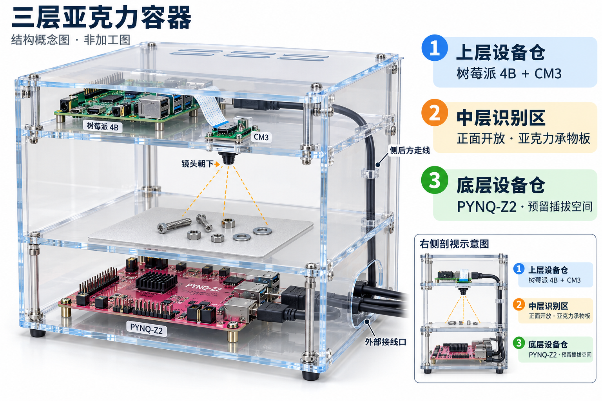

# 三层亚克力容器：结构概念图 v1

日期：2026-10-16。用途：确认板卡、摄像头、承物板和线缆的空间布局；不作为加工图。



## 本版布局

- 上层设备仓：树莓派 4B 与 CM3；CSI 排线留在上层。CM3 镜头经隔板开孔朝下，镜头与元件之间不隔亚克力板。
- 中层识别区：正面开放，用于取放元件；元件置于亚克力承物板上，可加可移除的哑光底衬。
- 底层设备仓：PYNQ-Z2 通过绝缘支柱固定在底板上；接口旁保留插头、插拔和线缆弯曲空间。
- 四块水平板分别为顶盖、上层隔板、承物板和底板，围成三个空间。
- 树莓派到 PYNQ 的 HDMI 线沿侧后方下行，避开镜头视野；下层侧面预留外部接线口。
- 树莓派和 PYNQ 分别供电，电气链路仍以 `board/hardware.md` 为准；本图只表达布置空间。

## 检查与未完成项

- 已完成图片目视核对：三个空间、向下镜头、中层元件、下层板卡、侧后方走线与外部接线口均有表达。
- 图中板卡外观、接口数量及相对比例属于示意，不作为实际板型或尺寸依据。
- 未实现：实物外壳、精确尺寸、板厚选型、孔位和激光切割/CAD 文件。
- 未验证：镜头至承物板的工作距离、视野覆盖、散热、结构刚度与实际线缆插拔间隙。
- 后续依据实际板卡、插头和识别区域测量后再确定加工尺寸；图片不代表这些项目已经通过验证。
- 此步只新增图片与说明，不涉及 RTL、软件接口或代码提交。

## 生成记录

方式：内置 imagegen 工具；新图生成，无参考图；非透明背景。
图片与完整提示词保存在本目录，便于后续比较修改；生成结果具有随机性，不承诺像素级重现。

完整提示词如下：

```text
Create ONE polished industrial design concept illustration of a THREE-TIER CLEAR ACRYLIC enclosure for an electronic component recognition workstation. This is a conceptual structural preview, NOT a dimensioned manufacturing drawing. Landscape canvas about 3:2, white background, excellent legible Simplified Chinese typography, clean professional technical product visualization, soft studio lighting, realistic transparent acrylic with restrained pale-blue edges and visible mechanical fasteners. Main image occupies left 70%, readable callouts on the right. Show an ASSEMBLED front-right isometric three-quarter view, with transparent side panels and selective cutaway for visibility, NOT an exploded view. Entire enclosure fully visible with generous margins. Three vertical spaces separated by exactly four horizontal structural acrylic plates: top lid, upper equipment shelf, middle object-support shelf, bottom base. The middle workspace is taller than each of the two electronics compartments. Transparent panels and corner supports form a plausible stable rectangular structure.

PHYSICAL ARRANGEMENT, mandatory: (1) TOP EQUIPMENT COMPARTMENT, a shallow hollow space between lid and upper shelf. One Raspberry Pi 4B green PCB lies horizontally on small insulating standoffs toward the left/back. One much smaller Raspberry Pi Camera Module 3 board is securely mounted horizontally facing DOWN near the center of the upper shelf; its lens protrudes below that shelf through a small camera opening. The camera is NOT on the roof. A short thin CSI ribbon cable connects the Pi to this camera inside the top equipment compartment. A subtle slotted mounting bracket supports the small camera. Pi and camera remain above the middle workspace. (2) MIDDLE OPEN-FRONT WORKSPACE, empty open volume between upper shelf and object-support acrylic shelf. Its front is OPEN so a hand could place parts inside, no front door. Camera looks straight downward from the underside of the upper shelf. The optical path contains NO transparent acrylic sheet in front of the lens: the lens peers through a hole and has unobstructed line of sight. Draw two or three subtle dashed amber field-of-view rays from lens to a few small screws, nuts, and washers arranged on the middle object-support plate. The support plate itself is clear acrylic; a thin removable matte neutral pale insert sits on it only beneath the objects to improve readability, do not depict a fourth compartment. The parts are ONLY on this middle plate, never on bottom base. (3) BOTTOM EQUIPMENT COMPARTMENT, shallow hollow space between object-support shelf and base. ONE larger PYNQ-Z2 development PCB lies horizontally on small insulating standoffs on the bottom base. Its ports face to the right or rear. Reserve visibly empty volume alongside its ports for connected plug bodies and gently bending cables; do not pack the board against the wall. Both boards schematic but recognizable and distinct, never duplicate them.

WIRING, mandatory: one HDMI cable runs from Raspberry Pi in top compartment, DOWN along a dedicated rear-right vertical corner cable route OUTSIDE the camera view cone, into an input connector on PYNQ-Z2 in bottom compartment. Make its routing clear and plausible; it must not dangle across the workspace or lie in the optical field. An external cable bundle containing power/network/video connections exits to the RIGHT through a broad rounded opening in the bottom side wall; clearly show bend clearance. Small top-side ventilation slots, no decorative lights, no monitor, no laptop, no robot arm, no unrelated equipment. A few corner screws and mounting standoffs are appropriate. No exact dimensions, no guessed measurements, no engineering tolerances.

TEXT: all annotations in clear correctly written Simplified Chinese, precisely these labels with fine leader lines ending on the correct physical region. Main title at upper left: "三层亚克力容器". Small subtitle: "结构概念图 · 非加工图". Three prominent right-side labels vertically aligned with corresponding spaces, with colored numbered markers: "① 上层设备仓" followed on next line by "树莓派 4B ＋ CM3"; "② 中层识别区" followed by "正面开放 · 亚克力承物板"; "③ 底层设备仓" followed by "PYNQ-Z2 · 预留插拔空间". Short fine callouts only where there is space: "镜头朝下" near the lens and arrow, "侧后方走线" near the rear-right corner cable route, "外部接线口" near the lower-right cable exit. Keep text outside physical object except small readable board name tags if desired. Avoid overlaps, garbled labels, excessive caption text and too many lines. Include a tiny non-dimensioned side-section inset in the LOWER RIGHT below the main three labels only if space permits, showing the same three spaces and the downward camera direction; omit the inset if it would crowd the labels. Prioritize one clear attractive main structural rendering with all THREE compartments distinguishable and the middle camera viewing volume very obvious.
```
