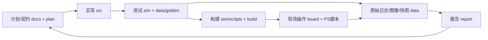

# 仓库逐文件说明

2026-10-13，`dev/model@c3b6a1e`及当时工作区。覆盖4604个项目文件，加上本索引工具与输出，共4637个文件，每个文件单独一条说明。
这是文件导航，不是验收报告；读取工作区内容，不能当作该commit逐字节源码快照。

先用[可搜索页面](index.html)查名字、作用或关联；偏好纯文本可读下面的Markdown目录，[完整CSV](files.csv)可筛选，[完整JSON](files.json)保留所有提取出的关系。

## 建议阅读路线

| 先读 | 解决什么问题 |
| --- | --- |
| [根README](../../README.md) → [主计划](../../plan.md) → [三人清单](../project-closeout-three-person-checklist.md) | 我们要做什么，谁负责，尚缺什么 |
| [核契约](../../src/riscv/design_v1.md) → [core_top](../../src/riscv/core_top.v) → [核测试](sections/sim.md) | 指令如何执行，停顿/转发/预测怎样验证 |
| [视觉契约](../../src/vision/design_v0.md) → [video_pipeline](../../src/vision/video_pipeline.v) → [vision_axi](../../src/vision/vision_axi.v) | 视频与分析怎样分流，PS如何改配置 |
| [C01基线](../c01-capture-implementation-baseline.md) → [捕获BD](../../sim/scripts/create_capture_hdmi_bd.tcl) | 显示旁路、状态和DDR取帧有哪些区别 |
| [PS入口](../../src/pynq_host/README.md) → [FILE服务](../../src/pynq_host/vision_live_service.py) → [EXE](../../src/vision_client/preview.py) | 一轮检查怎样经过服务、界面、记录 |
| [CNN契约](../../src/coprocessor/design_v0.md) → [整数参考](../../src/coprocessor/int8_reference.py) → [测试](../../sim/coprocessor/test_int8_conv.py) | 已冻结哪些算术规则，为什么还不能称硬件完成 |



## 目录索引

| 目录组 | 文件数 |
| --- | --- |
| [board](sections/board.md) | 19 |
| [build](sections/build.md) | 30 |
| [data-README.md](sections/data-README.md.md) | 1 |
| [data-evidence](sections/data-evidence.md) | 858 |
| [data-golden](sections/data-golden.md) | 29 |
| [data-logs](sections/data-logs.md) | 3067 |
| [data-metrics.csv](sections/data-metrics.csv.md) | 1 |
| [data-scripts](sections/data-scripts.md) | 6 |
| [docs](sections/docs.md) | 109 |
| [models](sections/models.md) | 3 |
| [report](sections/report.md) | 135 |
| [results](sections/results.md) | 22 |
| [root](sections/root.md) | 10 |
| [sim](sections/sim.md) | 200 |
| [skill](sections/skill.md) | 10 |
| [src](sections/src.md) | 137 |

## 如何理解关联

- **RTL例化 / Python导入**：在源码中找到的模块/导入关系；不等于整个链路已集成验证。
- **测试入口引用**：脚本明确提及的tb/测试名；动态拼接和条件参数可能未被静态扫描覆盖。
- **文本引用 / 文档链接**：文件中提到这个路径；不保证实际调用，也不代表历史引用仍是当前规范。
- **所在目录说明**：最近一层README，通常说明同轮输入、脚本、输出和版本；日志、截图、退出码要一起读。
- **对应的当前文件**：能从inputs/final-inputs等路径识别到的当前文件；这是导航对应，未做逐文件哈希等价断言。
- **同名配套 / 同目录输入与元数据**：把日志和退出码、PGM和hex、原图和metadata等并排连接；关系由文件名/目录确定，不凭此推断内容或哈希相符。

源码/核心脚本使用人工核对的说明；其他文件结合标题、字段、格式和同目录说明生成，说明依据在搜索页/CSV中可见。二进制模型/图片/第三方资料主要说明角色，不反序列化或执行，也不声称审核其算法正确性。

`data/logs`与`data/evidence`里的.v/.py/.tcl往往是归档副本，修改它们不会改变当前产品源码。`expected_*.hex`是测试答案，`input_*.hex`是激励；固件hex、反汇编和源程序是同一程序的不同表示。

MOCK/合成/FILE/PROTOTYPE与真实硬件证据分开。10/13工作区已新增CNN算子/整网控制器、诊断整数整网参考和custom单帧DDR适配，职责见本索引及[协处理器说明](../../src/coprocessor/README.md)；不能由“有文件”推导为正式模型、完整MMIO/DMA/核集成或实机验收通过。10/12的[核对清单](../implementation-document-audit-2026-10-12.md)保留当时状态，续工以实际文件/日期对应证据为准。

## 覆盖范围与更新

包含`git ls-files --cached`与`git ls-files --others --exclude-standard`中的文件；排除.git内部数据和被忽略的依赖/构建目录。已入Git但后来匹配忽略规则的证据仍包含；所有输出自身也有说明。

生成器仅读取项目文件并写`docs/file-guide/`。仓库根目录使用真实Python解释器运行：

```powershell
python docs/file-guide/tools/generate.py --date 2026-10-13
python docs/file-guide/tools/verify.py
```

[validation.json](validation.json)检查覆盖集合无遗漏/重复、全部关系目标在集合内、文件存在及说明无空白/乱码。该验证不代替源码功能回归、文件哈希审计或实机验收；索引更新时保留原始日志。
CSV逐项覆盖全部文件，关系栏最多列20项，完整关系保留在JSON/搜索页；这避免历史总索引中上千条引用塞进一个表格单元格。
