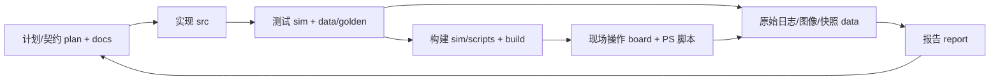

# 仓库逐文件说明（生成物）

__DATE__，`__REV__` 及当时工作区；范围：**__SCOPE__**。覆盖 __PROJECT_COUNT__ 个项目文件，加上索引工具与输出，共 __COUNT__ 个文件。
这是**生成物，不是权威入口**，也不代表验收结论；当前导航以 [docs/README.md](../../docs/README.md) 和 [docs/project-map.md](../../docs/project-map.md) 为准。

## 先读这些

| 先读 | 解决什么问题 |
| --- | --- |
| [根 README](../../README.md) → [主计划](../../plan.md) → [三人清单](../../docs/project-closeout-three-person-checklist.md) | 我们要做什么，谁负责，尚缺什么 |
| [项目地图](../../docs/project-map.md) | 目录、数据流、找东西、禁止事项 |
| [核契约](../../src/riscv/design_v1.md) → [core_top](../../src/riscv/core_top.v) → [核测试](sections/sim.md) | 指令如何执行，停顿/转发/预测怎样验证 |
| [视觉契约](../../src/vision/design_v0.md) → [video_pipeline](../../src/vision/video_pipeline.v) → [vision_axi](../../src/vision/vision_axi.v) | 视频与分析怎样分流，PS 如何改配置 |
| [C01 基线](../../docs/c01-capture-implementation-baseline.md) → [捕获 BD](../../sim/scripts/create_capture_hdmi_bd.tcl) | 显示旁路、状态和 DDR 取帧有哪些区别 |
| [PS 入口](../../src/pynq_host/README.md) → [FILE 服务](../../src/pynq_host/vision_live_service.py) → [EXE](../../src/vision_client/preview.py) | 一轮检查怎样经过服务、界面、记录 |
| [CNN 契约](../../src/coprocessor/design_v0.md) → [整数参考](../../src/coprocessor/int8_reference.py) → [测试](../../sim/coprocessor/test_int8_conv.py) | 已冻结哪些算术规则，为什么还不能称硬件完成 |



## 目录索引

| 目录组 | 文件数 |
| --- | --- |
__DIRECTORY__

## 如何理解关联

- **RTL 例化 / Python 导入**：源码中的模块/导入关系；不等于整条链路已集成验证。
- **测试入口引用**：脚本明确提及的 tb/测试名；动态拼接和条件参数可能未被静态扫描覆盖。
- **文本引用 / 文档链接**：文件中提到这个路径；不保证实际调用，也不代表历史引用仍是当前规范。
- **所在目录说明**：最近一层 README，通常说明同轮输入、脚本、输出和版本。
- **对应的当前文件**：能从 inputs/final-inputs 等路径识别到的当前文件；这是导航对应，未做逐文件哈希等价断言。

源码/核心脚本使用人工核对说明；其他文件结合标题、字段、格式和同目录说明生成。二进制模型/图片/第三方资料主要说明角色，不反序列化或执行，也不声称审核其算法正确性。

`data/logs` 与 `data/evidence` 里的 .v/.py/.tcl 往往是归档副本，修改它们不会改变当前产品源码；需要重建时按对应目录的 README/manifest 操作。

## 生成与校验

```powershell
python docs/file-guide/tools/generate.py --scope source --date __DATE__
python docs/file-guide/tools/verify.py
```

输出目录是 `build/file-guide/`（被 .gitignore 忽略），不提交。需要全量（含 data 日志/证据）时加 `--scope all`，但会很大且更易过期；日常导航优先用 [data/logs/README.md](../../data/logs/README.md) 和 [data/evidence/README.md](../../data/evidence/README.md)。

[validation.json](validation.json) 检查覆盖集合、关系目标、说明有效性；不代替源码功能回归、哈希审计或实机验收。
