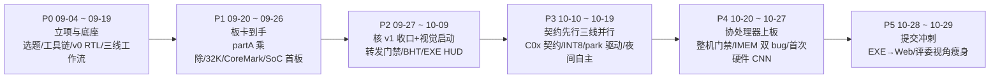

# EdgeSight（FPGA-Alittle-Design）人机协同开发记录与架构演进报告

> **项目对象**：面向 AMD PYNQ-Z2（XC7Z020）的受控工位紧固件识别与工业检查系统——自研 RV32IM RISC-V 核（v0 两级基线 → v1 三级流水/转发/分支预测）+ HDMI 视觉预处理流水线 + INT8 CNN 硬件协处理器 + 网页前端。
> **工程体量**：56 天记录周期（2026-09-04 → 2026-10-29，git 历史自 09-02 起）/ 全分支 668 次提交（main 线 657）/ 3 位 git 作者（never-die-cold 386、LibJiang 189、waltercooper 93 笔）/ 10-29 提交瘦身 git rm 4,003 文件后 tracked 3,476 / 9 个 skill 方法论包 / 5 个治理 tag。
> **实测指标**：v1 核 OOC 实点 86.806 MHz（BHT2 @11.52ns，WNS +0.538）；转发 CPI 降幅 10.20%（Radix-4 工作点）、组合优化 14.83%；CoreMark 四档 CPI 2.105 → 1.606；SoC 40 MHz 上板 LED 判据贯穿；协处理器整机门禁 WNS +2.078、DSP 136/220、BRAM36 69/140；2026-10-26 板上硬件 CNN 首次输出 zero/pattern 6/6 matches；10-28 CNN r6 实板 12 轮 85 个结果与整数参考逐项一致。
> **记录范围**：`report/llm_log/` 218 份协作记录（44 个开工日、14,007 行；另含 README/template 与 1 份补丁存档）+ 54 组 `data/logs/` 实验证据目录 + 9 组 `data/evidence/` 证据包；67 份记录含理解门槛全量落盘，133 份挂 `#skill候选`。

本报告为一次成稿的总览记录（2026-10-30），全部事实取自仓库内 `report/llm_log/`、`report/module1-closure.md`、`report/project-final-status-2026-10-26.md`、`plan.md` 与 `data/logs/` 索引，未采用仓库外素材；口径与统计细节见第四节。

---

## 目录

- [一、研发演进脉络与关键突破（P0–P5）](#一研发演进脉络与关键突破p0p5)
  - [P0 路线确立与工程底座（09-04 → 09-19）](#p0-路线确立与工程底座09-04--09-19)
  - [P1 板卡到手与核 v0 攻坚（09-20 → 09-26）](#p1-板卡到手与核-v0-攻坚09-20--09-26)
  - [P2 模块一 v1 收口与视觉线启动（09-27 → 10-09）](#p2-模块一-v1-收口与视觉线启动09-27--10-09)
  - [P3 契约先行与三线全速并行（10-10 → 10-19）](#p3-契约先行与三线全速并行10-10--10-19)
  - [P4 协处理器上板攻坚（10-20 → 10-27）](#p4-协处理器上板攻坚10-20--10-27)
  - [P5 提交冲刺与形态收敛（10-28 → 10-29）](#p5-提交冲刺与形态收敛10-28--10-29)
- [二、核心技术决策与架构演进](#二核心技术决策与架构演进)
- [三、人机协同工程方法论与创新实践](#三人机协同工程方法论与创新实践)
- [四、数据来源与口径说明](#四数据来源与口径说明)

---

## 一、研发演进脉络与关键突破（P0–P5）

研发全程由三名人类队员（组长 never-die-cold 统筹并主管验证线与板端、LibJiang 主管 RTL 与协处理器计算链、waltercooper 主管视觉服务与 EXE 前端）与多种 AI 工具协作完成；工具生态经历两次接力：**前期（P0–P1）由 Kimi Work 与 OpenCode 主导**完成选题、底座与 v0 核，**中后期（P2–P5）由 Codex、OpenCode、ZCode 多轨并行**完成核收口、视觉/EXE、协处理器与提交冲刺。



### P0 路线确立与工程底座（09-04 → 09-19）

- **技术命题**：三名大二集成电路学生参加 AMD 自主选题赛道初级组，需在三日内把"选题、叙事、仓库治理、开发底座"一次立起来。
- **关键动作与事实**：
  - 09-04：以官方评分权重（创新 30/性能资源 20/正确性完整 20/大模型协作 15/文档 15，见 `2026-09-04-project-kickoff.md`）修正旧权重口径，将模型给出的三选一方案融合为 EdgeSight 单一故事线（自研三级流水 RV32IM 核 + HDMI 预处理 + INT8 CNN 协处理器）。
  - 09-08：借野火 XC7Z020 作前置板评估，按"模块 × 资源需求"矩阵证明模块一纯 PL 与板卡差异免疫，仅"上板跑通"一项顺延（`2026-09-08-wildfire-board-interim.md`）；09-11 因 PYNQ-Z2 板载 Digilent SMT2 正式取消外购 JTAG（issue #3 not planned）。
  - 09-11 单日六线并进：获奖作品调研（搜索引擎全线失效后改走 `gh api` 命中国赛仓库）、plan1 合并与仓库治理（连续纠出死代理配置、gho token 权限缺口、`verify_rv32i.py` 十条用例期望值错）、RV32I 38 用例自检（test #25 小端序用例错而非核错）、工具链统一为 MSYS2 ucrt64 GCC 14.2.0（用户原话"不不不，我们工具链统一使用一个"）、v0 接口冻结与 v0 RTL 当日落地（`tohost = 13, tohost_exit = 0`）。
  - 09-14：仓库结构对齐赛道 §3.3.5.4（metrics→data、sw→src）；确立 dev/rtl、dev/verify、dev/bench 三线工作流与 protect-main Rulesets，并按规程做"拒绝测试"（直推实测 GH013 拒绝）；Vivado 决议 2026.1 BASIC 免费档（依据 UG973 量化限制）；OOC 综合首跑得 Fmax≈86.8 MHz 外推值（10-10 审注回填：86.8 为 WNS 反推外推、核主档实点为 86.806 MHz，原文保留不改）。
  - 09-15：验证线在写观察点前抓出 muldiv 契约级缺口——`muldiv_op` 2 位端口截断表达不了 RV32IM 八种 M 运算、`core_top.v:18` stall 硬编码——bug 被拦截在实现之前。
- **关键突破**：iverilog 13.0 + stub 核打通过渡仿真通路，使 Vivado 未就绪期不空转；确立"反汇编验证指令真实存在 + 独立编码器交叉核对，防工具链自证"原则；同日建立 llm_log 记录制度本身（六段纠错闭环：提示词→回答→失败→喂回→修正→验证）与 `#skill候选` 周度沉淀机制。

### P1 板卡到手与核 v0 攻坚（09-20 → 09-26）

- **技术命题**：PYNQ-Z2 到货后一周内完成板级点亮，并把 v0 两级流水核补齐乘除法、32 KB 存储与 CoreMark 负载。
- **关键动作与事实**：
  - 09-20 单日 12 条记录：LED 流水灯冒烟（XDC 仅取官方 Master XDC 并记 SHA256，禁止猜引脚）；OpenCode 独立复核 PR #15（iverilog 四组 + Vivado BUILD PASSED，WNS +4.094）；JTAG 真机上板确立"SD 卡=系统启动、JTAG=PL 下载"口径与"记录只写真发生的事"纪律；**理解门槛制度首个样板**——转发 tb 首轮 1.5/3 不及格，补课两轮后通过，问答全量落盘（`2026-09-20-fwd-tb-understanding-gate.md`）。
  - 09-21 → 09-22：partA 古法编程 13 步完成 muldiv（握手骨架 → 32 拍移位加乘法 → 恢复除法）；用户对 `product_neg` 的理解偏差被补测纠正；7B 整核接入后 **RV32IM 整核首次跑通 `tohost=142879`**，其中 AI 写错的两处（`rf_we` 写使能、`wb_data` 选路）由理解题补测抓出。
  - 09-23：CoreMark 移植踩坑——switch 跳转表在 `.rodata` 被链进 IMEM、lw 读 DMEM 得 0，trace tb 定位后确立**"同一镜像双预载 imem+dmem"范式**（后成为 arch-test/SoC 通用做法）；v0 32 迭代 PASS，`crcfinal=0x8799` 与 host -O2/-O0 三方一致，CPI=2.105、CoreMark/MHz=1.506（仿真外推口径）；32 KB 内存实现中抓出旧 tb 深度 4096 高位绕回"侥幸 PASS"；SoC 50 MHz 不收敛被构建门禁正确拦截 → 降 40 MHz 通过（WNS +0.142）。
  - 09-26：验证线独立复现 SoC 上板（XSim 与 iverilog 双工具对拍 + JTAG），并发现 BTN0 软复位后 LED=`0001` 的契约缺口——诊断为"软复位不清 dmem、固件拿旧 tohost 当种子"，可复现，回写契约而非改 RTL。
- **关键突破**：riscv-arch-test 接入（双预载镜像解法，签名比对判据不来自自己）；第三方负载（CoreMark）立项确立性能话术的实证基础；"WNS 合格 ≠ 已上板"成为贯穿全程的验收纪律。

### P2 模块一 v1 收口与视觉线启动（09-27 → 10-09）

- **技术命题**：两条并行线——模块一 v1 三级流水/转发/分支预测的契约、实现与收口；模块二视觉 RTL 的 720p60 时序攻坚与 EXE 演示前端。
- **关键动作与事实**：
  - 09-27：`design_v1.md` 逐节冻结，规定**对照档=同一份 RTL + `ENABLE_FORWARDING` 参数**（禁止复制第二份 core_top）；契约级总复核 3 题通过后才准进入 RTL（`2026-09-27-partB-v1-contract.md`）。
  - 09-29 → 10-02：v1 积木 R2–R5 模块级落地（hazard 验收 tb 16,020 例）；09-30 五分支合并（PR #46）；同日工业视觉计划定案产品形态与 M1–M4 里程碑，视觉状态盘点产出 12 项决策单 D1–D12，用户拍板 720p60 正式目标；10-01 视觉独立 worktree 与主工作区并行（scaler 切拍重排 57.5 → 94.9 MHz）；10-02 离板收口（22 视觉 tb + XSim 23 PASS，原子配置契约 R11/R12 推翻 D10 旧口径）。
  - 10-05（partB 高峰日，9 条记录）：转发正式双档实测 CPI fwd 2.169570 / nofwd 2.361854，**增益 8.14%，原 25% 门禁 FAIL**；上限分析证明仅转发数学上无法达 25%（16.13%）；据此修订验收口径（≥8.0% 回归门禁 + 25% 组合尽力目标），原始 FAIL 日志永久保留；同日组长对上板验证记录提出 REQUEST_CHANGES 五点（8.14% 张冠李戴、Fmax 外推当实测、证据不入库等）；Radix-4 乘法落地后 21.95%（乘法）/10.20%（新工作点转发）/28.30%（组合）三项分类记账不得混记；125 MHz SoC FAIL（WNS −8.044）留档。
  - 10-06 → 10-07：BHT 64 项三档接入，四档 CPI 1.885683/1.693399/1.616374/1.606122（组合 14.83%）；降深度系列（分支比较解耦 ALU、flush 只清 valid、PC/flush 互斥掩码相或等）；10-07 **模块一正式收口**（PR #60）：arch-test I+M 子集 44/44 签名匹配、XSim 四档对拍、BHT2 以 11.52ns 约束实点 86.806 MHz 通过（WNS +0.538，最差路径 17 级 → 12 级）、SoC 40 MHz 上板 LED=1101。
  - 10-08 → 10-09：EXE 演示线（Windows 桌面程序）连续纠错——实机状态 flap 2.5 分钟 576 条往返，根因跨机时钟不同源，修为接收时基 received_at 后仅 1 条；"重复帧不计数"改为结构性保证；HUD v4 参照用户生图落地（性能 124.7 → 16.3 ms/帧，7.6×）；10-09 module1-2-closeout 确立三层状态口径，16 份核 RTL SHA256 与 manifest 一致，并重申**旧 8.14%/21.95%/28.30% 不得由当前 14.83% 倒填**。
- **关键突破**：转发门禁从"设计预测"转为"实测基线 + 数学上限分析"的口径治理范式；时序上"外推/实点/板上"三档口径冻结；双线并行的多 worktree 协作模式跑通。

### P3 契约先行与三线全速并行（10-10 → 10-19）

- **技术命题**：协处理器以契约先行方式从零起步；视觉数据入仓与真实链路首跑；仓库治理与审查机制升级。
- **关键动作与事实**：
  - 10-10 契约日：C02（FastenerCNN 整数契约：64×64 灰度 ROI、对称 INT8 权重、multiplier+右移+饱和、8×16 MAC@100MHz）与 C03（MMIO/AXI4-Lite + DMA、PS 定位/ROI 分工）冻结；纠错闭环——0.933 ms 被误读为延迟，按 O16×I8 调度重算 101,384 拍 ≈ 1.014 ms；确立"16 目标协议能力 / 10 件业务策略"分层；INT8 标量/张量/卷积 Python 黄金参考三件套；数据集防泄漏审计（13 组回归）；外协视觉材料 48 文件 SHA256 全对入仓；同日 dev/exe 提交 **LIVE 报文契约 v1.2 冻结**（commit `7101a33`）。
  - 10-11 → 10-14：N03 现场诊断（vision 段错误定位、HWH `C_AUX_RESET_HIGH=0` 总线永久复位根因修复）；CNN MAC step1 以 65,035 向量穷举 PASS；J01 交叉审计设三道硬门槛；三 PR 审查确立"标识恒显、证据跟事件走、黄金不发明语义"三原则；CNN 大实现 WNS −19.892 → 分拍后 +0.058（192 DSP），整网 1,123,109 拍；C04 应用语义评审。
  - 10-15 → 10-17：DDR 单帧所有权根因收敛——停机粘滞位 SR=0x14811 是电平型状态，"停机期清干净再 RUN"物理不可满足，清除须在 RS=1 暖机窗口 → **park 驱动路线**；快速模式整网 1,123,109 → 472,593 拍、DSP 192 → 136、LUT 10,100 → 4,540；10-16 全链首跑（真实相机 → 采集 → 定位 → 板上 NumPy CNN → 判定 → v1.2 LIVE 包，板上 NumPy 与 PC torch 逐元素差 ≤2e-5，6 目标全判 bolt、RECHECK 如实记录）；10-17 EXE 环联通（板端 8765 端口 POST /v1/check 121.6 s 返回合法 v1.2 包）；owner 纠正 agent 两处归因并回写契约。
  - 10-18：cop_job 固件 52 行 RV32I 与主机共用判定头文件；**J04-1~J04-28** 二十八步逐级放行（MMIO 门/CDC 邮箱/原子配置/DataMover/CRC32 门禁/ABORT/SOFT_RESET/PS 权限），每步独立 tb + all 回归；同夜**夜间自主模式**首跑——分支 `codex/night-2026-10-18`，以"第零阶段三类清单 + 显式禁区 + 每步闭环本地 commit 绝不 push"替代白天理解门槛，当夜 15 个本地提交（`2026-10-18-night-autonomous.md`）。
  - 10-19：PR #79–#83 顺序合并；**DeepSeek 独立审查** Codex 的 PR #86 提出五条 P2（重试误杀、CHECK_FAIL 判定、退出码吞没、无 pipefail、"24/24 匹配"实为 23/24），同日复核确认 R1–R5 全部成立并修复（含负向对照）；仓库清理七步收官——5,638 → 5,125 跟踪文件、工作区 3.9 GB → 469 MB，删除全程可回退（tag `post-cleanup-2026-10-19` + manifest + 隔离区）。
- **关键突破**：契约冻结 → 交叉审计 → 逐级放行的协处理器工程节奏；量化黄金链使 RTL 有逐位对拍基准；"夜间量产 + 白天守门"的异步人机分工成立。

### P4 协处理器上板攻坚（10-20 → 10-27）

- **技术命题**：把仿真全绿的协处理器送上真实板卡——跨过 BRAM 端口带宽、生产/消费握手、整机时序门禁、DMA 位宽与 IMEM 初始化五道坎。
- **关键动作与事实**：
  - 10-20 → 10-21：K2 存储方案发现"容量算得下、单拍凑不出 128 B 带宽"→ 16 路 × 64-bit 权重 bank；K3 真实读延迟 BRAM 逐元素对拍（cycles 472,594 vs 472,593 差 1 拍，且"早/晚一拍采样必须可见失败"的门禁用例守住边界）；消费握手裁决（READY 降为建议性、sticky ACCEPTED、PS 独占 CONSUME、RESULT_SEQ 单调，T1–T7 逐条 PASS）；固件 E2E 抓出 result_data 字段拼接位宽错位。
  - 10-22：Windows Vivado 实跑整机门禁——首跑被 UTLZ-1 拦截（LUT 57,380 > 53,200，ROI 被拆 32,768 寄存器）→ 1R1W RAM 模板修复；整机综合通过但 no_clock 480 项 FAIL（非时序）→ 修复后 PASS（WNS +2.498）；120 个常 1 LDCE 锁存根因 = 异步复位漏载荷链复位赋值，修复后建立 CDC 五条 fail-closed allowlist；同日冻结**整机门禁定义**（WNS≥0、DSP≤220、BRAM36≤140、check_timing 四项全 0、DRC 0、LATCHES=0；OOC 资源相加不得冒充整机）。
  - 10-23 → 10-24：跨平台输入护栏（manifest 显式 UTF-8/ASCII + LF，CRLF 拦截）；两次独立构建仅文件头 4 字节不同；首次 bringup——烧写后未复位 AXI 不响应（`xsdb rst -system` 恢复）、FCLK1=142.857 MHz 被时钟门禁拦截记 UNVERIFIED、**DMA `C_SG_LENGTH_WIDTH=14` 上限 16,383 B < 36,032 B payload 被拒且明确禁分包**（每笔 DMA 产生 TLAST）；loader fail-closed（manifest/SHA256/CRC32/HWH 四重校验）。
  - 10-25 → 10-26：DMA 位宽 14 → 16 与固件驻留（等 CFG_VALID、DMA_BYTES 核对）；IMEM 返工——**板上 NO_ACK 定位为 `$readmemh` 相对路径在综合 run 目录未命中，TB 载入不能证明 bit 带 IMEM 初值** → 绝对路径 + 首三字校验（00008117）+ RAMB INIT 回读 + 综合日志扫描四重门禁；10-26 **双代理冲刺**：Agent A 构建线（新 bit 整机门禁 PASS + edge-fix.patch 交接）、Agent B 上板线（用 IMEM 修复 bit fast-run **zero/pattern 各 3 轮共 6/6 matches_expected=true——协处理器首次实板硬件 CNN 输出**）；随后定位第二个 bug：dma_start_ps_i 电平在 ACK 返回后二次触发清掉 loading_o → RTL 上升沿检测修复 + TB 断言"高电平只发一次"。
  - 10-27：A/B 变体（核+协处理器 / 含视频）从构建开关与包清单两端隔离；A 包门禁 PASS（WNS +2.078，包内 116/116 SHA256 OK）；closeout 只读审计 **24 项问题（阻断 5/高 9/中 7/低 3）**，含"门禁原始报告未入 Git、唯一有效包未跟踪"等证据链缺口；PR #89 合并——HDMI 采集 + 硬件推理接入 LIVE API；协处理器海报文案建立"文案 ↔ 路径:行"溯源表，禁止写无实据的精度/时延数字。
- **关键突破**：建立"仿真通过 ≠ 综合通过 ≠ 门禁 PASS ≠ bit 带固件 ≠ 板上可复现"的五级证据链；电平/脉冲握手错配与 IMEM 初始化两类"板上独有"bug 的完整发现-修复-守门闭环。

### P5 提交冲刺与形态收敛（10-28 → 10-29）

- **技术命题**：11 月 4 日 18:00 提交前，把前端形态收敛到可评审状态，并以"评委视角"完成仓库瘦身。
- **关键动作与事实**：
  - 10-28：EXE HUD v4 网页化原型一日落地（单文件零依赖，复用仓库字体，1366×768 不破版）；浏览器实测纠出 7 个 bug（overlay 覆盖 hidden、freshnessLoop 未启动、注入场景被自动轮消费等），11 个状态截图走查全通过；用户实测反馈"数据源开关点了没反应"→ 加 pointer-events:none（`2026-10-28-exe-web-hud-prototype.md`）。同日决策前端定为 HTML 网页端、全仓退役 EXE 桌面形态：第一轮 53 文件 +182/−2019，EXE 代码/构建/测试全套移除，轮次/记录/导出三个语义件移入 `src/pynq_host/`（保留回归依赖），doc-cleanup 两遍式修 18 处断链，hygiene 0 ERROR、468 链接 0 死链（`2026-10-28-webfront-switch-exe-removal.md`）。
  - 同日（plan.md 口径）：CNN r6 上板——新共存位流整机门禁通过（WNS 1.359/WHS 0.012），两组真实 ROI 共 12 轮 85 个结果的 logits、类别、margin 与整数参考逐项一致；新摆放留出 9 件中分类一致 9/9 但 FP32/INT8 各 8/9（垫圈判螺母），换实物泛化验收如实标注未实现。
  - 10-29：提交瘦身——git rm 4,003 个 tracked 文件（删前 180 MiB tar 备份），tracked 收至 3,476；76 处断链经复活 12 组引用后 `check_repo_hygiene.py` 收敛 PASS；**折返教训**：连根砍 arm-localize-baseline 导致两个回归组失败（消费 `two_targets.json` 439 B 与组包脚本），按最小子集恢复——"删整目录前必须 grep 测试 fixture 消费关系，管道 tail 会吞退出码不可作门禁写法"（`2026-10-29-submission-slim.md`）；PR B 追加五件 MAC 原语连契约退役；llm_log 记录全量保留（评委加分项）。
- **关键突破**：交付形态从桌面 EXE 收敛为网页端；"瘦身不回退"（备份 tar + git 历史指针 + 失败留痕）完成提交前最后一次大规模删除。

---

## 二、核心技术决策与架构演进

生命周期内的重大架构变更均遵循"实测数据驱动、口径先行、失败留痕"原则：

```
[原构想] 三选题并行推进            ──(评分权重/工程量)──▶ [P0] EdgeSight 单一故事线（核+视觉+CNN 互为加分项）
[工具链] 多平台并行方案           ──(用户裁决)────────▶ [P0] 唯一 MSYS2 ucrt64 工具链 + iverilog 过渡仿真
[CPI 门禁] 相对 v0 降 25%          ──(8.14% FAIL+上限16.13%)▶ [P2] 同核无转发基线 ≥8.0% 回归门禁 + 分类记账
[存储] 哈佛口单口加载             ──(跳转表读 0 跑飞)──▶ [P1] 同一镜像双预载 imem+dmem 范式
[时序] 100 MHz 设计目标           ──(外推/实点分离)───▶ [P2] 实点 86.806 MHz 冻结门禁 + SoC 40 MHz 上板
[视觉同步] 逐帧 frame_id 关联      ──(跨机时钟漂移)───▶ [P2-P3] 轮次级 v1.2 协议（session_id+config_id+年龄窗口）
[CNN 路径] NumPy 过渡引擎         ──(量化黄金链就绪)──▶ [P4] INT8 硬件协处理器 + 五级证据链
[DDR 取帧] 停机期清标志再 RUN     ──(粘滞位电平型)───▶ [P3] park 暖机窗口驱动 + 复制窗口零豁免
[交付形态] Windows EXE 桌面        ──(评审/维护成本)──▶ [P5] HTML 网页端 + 评委视角仓库瘦身
```

1. **指标口径治理：从"25% 预测"到"实测基线 + 分类记账"（09-20 → 10-09）**
   - *决策背景*：v0 核无数据停顿（CPI≈1）使"相对 v0 降 25%"数学不可达；转发实测仅 8.14%。
   - *决定与依据*：门禁重定义为"同一三级核开关转发 CPI 降幅 ≥8.0%"；Radix-4（21.95%）、BHT（5.15%）与转发（10.20%）分类记账；原始 FAIL 日志与 125 MHz FAIL 永久保留，后续会话不得倒填历史口径（10-09 两份收口记录重申）。
2. **哈佛核跑 C 程序的双预载范式（09-23）**
   - *决策背景*：CoreMark 跳转表链进 IMEM 而经数据口读取得 0，程序跑飞。
   - *决定与依据*：`.data`/`.rodata` 必须经数据口可见——同一镜像双预载 imem+dmem，成为 arch-test、CoreMark、SoC 三处统一范式。
3. **时序口径三档与整机门禁（09-14 → 10-22）**
   - *决策背景*：86.8 MHz 外推值曾被误当实测；部件 OOC 相加会冒充整机资源。
   - *决定与依据*："外推/实点/板上"三档口径冻结（外推不得当基线，10-10 审注回填原文不改）；整机门禁断言 WNS/DSP/BRAM/check_timing/DRC/LATCHES/CDC 全量，fail-closed allowlist 按 ID/Severity/Count 逐条命中。
4. **视觉 720p60 目标与 scaler 重排（09-30 → 10-01）**
   - *决策背景*：scaler OOC 仅 57.5 MHz（主凶 lerp 乘法 9 级 CARRY4 链），威胁 720p60 全链。
   - *决定与依据*：切拍重排读调度后 real 档 94.9 MHz，全链正裕量；ADV7611 缺席定案 dvi2rgb/rgb2dvi 路线。
5. **轮次级同步契约 v1.2 与接收时基（10-06 → 10-10）**
   - *决策背景*：实机 576 条 stale↔ok flap 证明跨机时钟不同源，逐帧关联不可靠。
   - *决定与依据*：D1 拍板判据=session_id+config_id+年龄窗口，frame_id 仅透传；EXE 以接收时刻 received_at 为本地时基；协议 v1.2 于 10-10 冻结（16 目标能力上限）。
6. **契约先行与"能力/策略"分层（10-10）**
   - *决策背景*：协处理器三线并行，无契约会出现实现冒充接口、协议能力冒充业务能力。
   - *决定与依据*：C01–C04 四份契约先冻结后写码（DDR 所有权/整数语义/集成分工/应用语义）；"16 目标协议能力 vs 10 件检查策略"分层；契约缺口只登记不放宽（Q01 白名单、FILE 16 超限映射零计数均按此处理）。
7. **INT8 逐位黄金链与快速化（10-10 → 10-15）**
   - *决策背景*：量化 RTL 无法靠"看起来对"验收，必须有逐位基准。
   - *决定与依据*：标量→张量→整网三层 Python 黄金 + 65,035 向量 MAC 穷举 tb + J02 zero golden（logits=04fd02、cycles=472,593）；INT64 中转防回绕、溢出拒绝不饱和；快速模式将整网 1,123,109 → 472,593 拍、DSP 192 → 136，黄金逐位不变。
8. **板级攻坚三课（10-15 → 10-26）**
   - *决策背景*：三组 bug 只在真实板卡暴露。
   - *决定与依据*：①停机粘滞位为电平型 → park 暖机窗口驱动（10-15）；②`$readmemh` 相对路径导致 bit 不带 IMEM 初值 → 四重 IMEM 门禁（10-25/26）；③dma_start 电平在 ACK 后二次触发 → PS 域上升沿检测 + TB 断言（10-26）。
9. **交付形态收敛：EXE → Web，评委视角瘦身（10-28 → 10-29）**
   - *决策背景*：EXE 桌面形态维护成本高、与网页化原型重复；仓库含大量历史产物。
   - *决定与依据*：前端定为 `src/web_client` HTML 网页端，EXE 全套退役（语义件移 `src/pynq_host/` 保回归）；瘦身以"删前备份 + 断链收敛 + fixture 消费关系核查"为纪律，llm_log 与官方锚点证据全保留。

---

## 三、人机协同工程方法论与创新实践

### 3.1 工具分工与多轨独立审查流水线

| 工具实体 | 运行环境 | 核心工程角色 | 接入周期 | 留存核心工程资产 |
|---|---|---|---|---|
| **Kimi Work**（Kimi/Moonshot） | 网页工作区 | 选题决策、板卡评估、早期 README | 09-04 → 09-08 | 选题融合方案、野火前置板评估矩阵 |
| **OpenCode**（deepseek-flash / v4-pro / v4.1-flash / opencode-go / glm-5.3-flash） | 本机 CLI | 工程主线：契约审计、RTL 实现、验证接入、回归体系 | 09-11 → 10-29 贯穿 | llm_log 多数执行记录、arch-test/CoreMark 接入、C 契约与 J 线协作 |
| **Codex**（GPT-5 / GPT-6 Astra，WSL） | 本机 WSL/桌面 | partA/partB RTL 实现、协处理器 J 线量产、夜间自主 | 09-20 → 10-27 | muldiv/v1 积木、CNN 大实现、J04 28 步、夜间 15 提交 |
| **ZCode**（GLM-5.3-Flash） | 本机 | 记录补档、状态盘点、只读审查、提交冲刺执行 | 09-30 起间断介入 | D1–D12 决策单、离板收口、10-28/29 前端切换与瘦身执行 |
| **DeepSeek**（经 PR 独立复审） | 远端 PR | 对 Codex 9 提交的独立审查 | 10-19 | 五条 P2 全部成立并修复（含负向对照） |
| **人类三人**（never-die-cold / LibJiang / waltercooper） | — | 拍板裁决、理解门槛答题、板端实操、PR 评审 | 全程 | 668 次提交、三分支作者、五点 REQUEST_CHANGES 等关键纠偏 |
| **Raspberry Pi 4B** | 板端开发机 | R1–R4 开发联调辅助（不进产品分析路径） | 10-03 起 | pi-dev-roles 定案、数据采集联动 |

协同模式的关键在于**不依赖生成代码的代理自我验证**：实现代理（Codex/OpenCode）交出代码后，验证线独立复现（XSim 与 iverilog 双工具对拍、独立 tb 预写）、跨工具独立审查（DeepSeek 复审 Codex、owner 五点纠偏、closeout 只读审计）与人类理解门槛三轨并行；任何"已验证"结论必须能由仓库内脚本一键复现。

### 3.2 理解门槛：入库前的"讲得清"守门

本项目将"人如何验证并理解 AI 产出"制度化为硬门禁（`docs/workflow.md` §2、`skill/understand-gate/SKILL.md`）：**AI 生成的代码 commit 前须通过逐段讲解 + 3 道理解测试题，答错补课再测，全过程全量落盘 llm_log**（67 份记录含理解门槛内容）。运行形态包括：

- **逐题把关**：首个样板（09-20 转发 tb）首轮 1.5/3 不及格，补课两轮后通过；判定记录保留错误方向而非只记对错。
- **契约级门槛**：`design_v1.md` 冻结前总复核 3 题（load→branch 时序、RV32M 复述、指标板级），通过后才准写 RTL。
- **流程偏差如实留痕**：arch-test 接入曾"commit 后补题"，被记录为流程偏差；10-27 PR #89 的 3 道题"留后未代答"。
- **题目反向纠偏人机双方**：用户曾答错 `product_neg`（09-21），owner 曾借答题纠正 agent 的两处归因（10-17）。
- **集中应答模式**：用户曾声明"理解题我最后一块做，我先越权全部跑完"（`2026-10-01-vision-m2-sprint.md`）——门槛节奏可协商，落盘不豁免。

配套的**古法编程**（`skill/gufa-programming/SKILL.md`）约束实现节奏：单步 ≤100 行、先设计后写码、每步出题；夜间自主模式下以"每步闭环 + 本地 commit 绝不 push"替代，白天补门（10-18）。10-22 曾出现一次"单 commit 超 100 行"临时豁免，由 JL 授权并留痕。

### 3.3 黄金参考与三态口径：确定性质量闭环

与 Mozart 类案例同理，FPGA 开发的静默失效（位宽截断、量化溢出、初始化缺失）无法靠"能跑"发现。本项目建立三层守门：

1. **黄金参考链**：视觉黄金参考 6 套（≤2 LSB）；INT8 标量/张量/整网 Python 逐位黄金；65,035 向量 MAC 穷举；J02 zero golden 逐位锁定；板上 NumPy CNN 与 PC torch softmax 逐元素差 ≤2e-5；CoreMark 三方复算（host -O2/-O0/RTL 同 `0x8799`）；arch-test 44/44 签名匹配官方 golden。
2. **三态口径**：每项产出标注仿真 / 综合（门禁）/ 板上（UNVERIFIED 直至实测）三态，禁止把综合 PASS 冒写板级 PASS（10-27 审计确认全库未发生该类虚写）；包级证据以 SHA256 manifest 与"旧包哈希废止制度"管理（10-23/10-27 多次废止旧包）。
3. **仓库级门禁**：`check_repo_hygiene.py`（根目录白名单、预算、断链、生成物）；整机门禁（WNS/DSP/BRAM/check_timing/DRC/LATCHES/CDC allowlist）；loader fail-closed 四重校验；data/logs 六要素目录（日期/commit/命令/结果/产物/边界）54 组，构成"已验证"结论的一键复现入口。

### 3.4 研究与执行隔离：夜间自主、双代理与独立审查

- **夜间自主模式**（10-18）：第零阶段全量阅读并产出"已实现 / 未完成系统级验证 / 未实现"三类清单，划出显式禁区（冻结契约、核语义、综合与上板禁碰）；夜间以每步闭环 + 本地 commit 推进，**绝不 push**，把入库裁决留给白天的人类与门槛流程。
- **双代理分工**（10-26）：构建线 Agent A 与上板线 Agent B 并行——A 产出新 bit 与 `edge-fix.patch` 并写 HANDOFF 交接，B 在板上用旧 IMEM 修复 bit 复跑并完成首次硬件 CNN 输出；写入权限按线隔离，A 线文件因 `.git/index.lock` 未及 commit 并如实记录。
- **独立审查轨**：DeepSeek 复审 Codex 的 PR #86 得五条 P2 全部成立（含"24/24 匹配"实为 23/24 的交接单失实）；10-27 closeout 只读审计 24 项问题（阻断 5/高 9/中 7/低 3），直接暴露"门禁原始报告未入 Git、有效包未跟踪"等证据链缺口；owner 的五点 REQUEST_CHANGES（10-05）则代表人对 agent 结论的最终裁决权。

### 3.5 协同过程的反思与局限性控制

1. **AI 生成错误类型学**（P1–P3 累计）：接口位宽/选路错误（`rf_we`、`wb_sel`、result_data 拼接）、测试程序自身写错（阶段 D 分支条件、test #25 期望值）、环境假设错误（`$readmemh` 相对路径、CRLF、`/tmp` 清理）、过度自信口径（0.933 ms 误读、"23 个 tb 均未实现"过时文档）——五类均由 tb/审计/trace 而非人工肉眼首抓。
2. **口径事故与审注回填**：86.8 MHz 外推被混用作实测，10-10 全库审计以"原文保留不改 + 审注回填"方式纠正；8.14% 曾被张冠李戴为当前收益，组长五点纠偏后以分类记账固化。
3. **流程偏差与豁免留痕**：补题晚于 commit、3 题留后未代答、单 commit 超 100 行豁免——均有记录，未发生无痕绕过。
4. **环境脆弱性成本**：GBK 乱码、MSYS2 TMP、沙箱 socket 拒绝、`.git/index.lock`、Vivado 路径分裂（D:\vivado vs D:\Vivado_downloads）、Windows 商店 python stub 等环境问题反复消耗会话，后以 skill 包（pynq-z2-bringup 等）沉淀排查路径。
5. **失败资产保留制度**：8.14% FAIL、125 MHz FAIL、0x8799 前的跑飞 trace、折返的 fixture 删除（10-29）均永久留档，作为方法论提炼（9 个 skill 包）的原始素材。
6. **覆盖局限**：llm_log 按"设计决策点"口径记录、不记流水账，部分执行细节仅存于 data/logs 的 README；本报告数字均标注出处文件，但未对全库做第二轮独立审计。

---

## 四、数据来源与口径说明

- **素材范围**：`report/llm_log/` 2026-09-04 至 10-29 共 218 份记录文件（52 份 9 月、166 份 10 月，覆盖 44 个开工日，合计 14,007 行；另有 README/template 与 1 份补丁存档不入统计）；全局状态取自 `plan.md`（2026-10-28 版）、`report/module1-closure.md`（10-07）与 `report/project-final-status-2026-10-26.md`；证据目录 54 组（data/logs）、9 组（data/evidence）。
- **统计口径**（2026-10-30 实测）：git 全分支 668 提交、main 线 657；本地分支 7（5 条 dev 线 + fix/imem-init + main）；tag 5（partA-v0、pre/post-cleanup 与 pre-branch-merge-2026-10-19、archive/pi-hdmi-diagnostics）；`#skill候选` 133 份；理解门槛内容 67 份；skill/ 目录 9 个方法论包。
- **多口径并存原则**：同一指标存在历史口径差异时并列标注来源与日期（如 86.8 MHz 外推 vs 86.806 MHz 实点；8.14%/10.20%/14.83%/28.30% 分类记账；10-19 清理后 5,125 文件 vs 10-29 瘦身后 3,476 tracked），不作合并改写。
- **与参照体例的差异**：本报告为一次成稿，无"原句 → 改句 → 理由"润色对照章节，以本节口径说明代之；所有引用文件均位于 `report/llm_log/` 下，文件名即出处。
- **当前未闭环（截至 10-29，承接 plan.md §3.1）**：真实相机 → 板 → PS → 前端全链整机验收、正式 INT8 模型/生产黄金、换实物泛化验收、工位实测矩阵（N10–N12）未完成；含 DMA start 上升沿修复的 edge-fix bit 与 trained 包已构建未上板（BOARD UNVERIFIED）。本报告如实记录该状态，不构成完赛声明。
